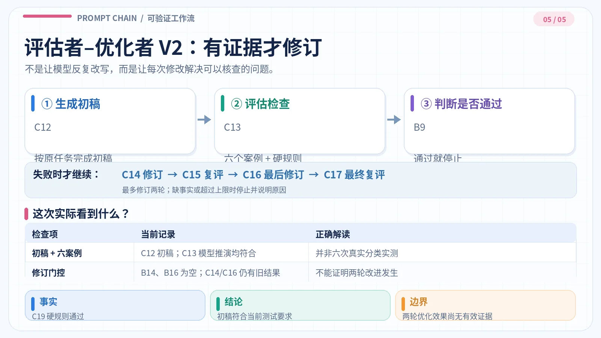

#+TITLE: 提示链案例解析
#+WIKI_ID: c596dd07-857d-4bff-b7e3-b3b9f5e1571d
#+CATEGORY: 提示工程
#+FILETAGS: :prompt-engineering:llm:gemini:google-sheets:
#+DATE: 2026-10-28
#+SOURCE: 2026-10-28 本次对话整理；Gemini Google Sheets 三步测试表尚未完成真实模型执行
#+INGEST_ID: 8f63a831-7fd2-4c17-888d-34dc896c6e8c
#+WIKI_STATUS: published

#+ATTR_HTML: :width 100%
[[file:../../../note-assets/c596dd07-857d-4bff-b7e3-b3b9f5e1571d/prompt-chain-header-unified-v4.webp]]

提示链不是调用次数越多越好，而是根据任务关系选择处理方式，并明确每一步怎样验收。本文以 [[https://docs.google.com/spreadsheets/d/1eV1Eg9KO0aTEuhhaN2cFVPVhjwk2zclBuPeCW4eLeP8/edit][Google Sheets《提示链》]] 的五组案例比较机制、当前输出与失效条件。

| 模式 | 运行方式 | 当前发现 |
|------+----------+----------|
| 顺序 | 前一步产出作为后一步输入 | 事实检查未覆盖字数 |
| 路由 | 先分类，再执行专用提示 | 改写结果仍有占位符 |
| 并行 | 独立审查，再合并意见 | 单个审查视角可能漏检 |
| 编排者–执行者 | 按实际缺口分配任务 | 将原有要求误认作新问题 |
| 评估者–优化者 | 失败才修订，复评防止退步 | 初稿通过，但无有效修订证据 |

*证据口径*：单元格公式、当前显示值、模型推演、确定性规则、真实案例实测不是一回事。=AI()= 公式存在不能证明最新调用时间；“通过”也不自动等于实际任务完成。各步骤的原始提示、全部公式与完整输出保存在上述工作簿中，本文保留核查所需的单元格位置和关键结果。

* 五种工作流与实际结果

** 顺序提示链：提取、生成、核查

流程：=B2 → C2 → B3 → C3 → B4 → C4=。先提取提示的四类要素，再生成介绍文案，最后检查有没有增加原材料没有的事实。

#+CAPTION: 顺序提示链示意，非模型运行回执。
#+ATTR_HTML: :width 100%
[[file:../../../note-assets/c596dd07-857d-4bff-b7e3-b3b9f5e1571d/sequential-prompt-chain-unified-v5.webp]]

| 步骤 | 当前输出 | 核验 |
|------+----------+------|
| =C2= 提取 | 指令、上下文、输入数据、输出格式及作用 | 作为后续文案的事实依据 |
| =C3= 生成 | “提示词由指令、上下文、输入数据和输出格式四类最小原子要素构成，分别用于定义具体任务、提供背景约束、传递待处理内容及规定输出结构。” | 64 字符，超过 =B3= 规定的30字 |
| =C4= 事实核查 | “无” | 仅表示未报告新增事实，不代表长度合格 |

*结论*：若验收要求同时包含事实、字数、格式，就必须分别检查。=C4= 只覆盖事实，无法替代长度检查。=C3= 是当前留存文本，不推断其生成时间。来源：[[https://docs.google.com/spreadsheets/d/1eV1Eg9KO0aTEuhhaN2cFVPVhjwk2zclBuPeCW4eLeP8/edit#gid=1602514994][查看工作表]]（=A2:C4=）。

** 路由提示链：分类后执行

流程：=B2 → C2 → B3 → C3=。=B3= 用 =SWITCH(TRIM(C2), …)= 从“概念解释、提示改写、提示检查”中选择专用指令，并从 =B2= 取回原请求；遇到无效类别则停止。

#+CAPTION: 分类、路由与专用任务示意。
#+ATTR_HTML: :width 100%
[[file:../../../note-assets/c596dd07-857d-4bff-b7e3-b3b9f5e1571d/routing-prompt-chain-unified-v2.webp]]

| 位置 | 当前显示 |
|------+----------|
| =C2= | 提示改写 |
| =C3= | “请用通俗易懂的语言向初学者解释‘路由’的概念，重点说明它的基本定义、核心功能与工作原理[待补充]。” |

*结论*：分类进入了改写分支，但交付物仍有 =[待补充]=；不能仅凭路由成功认定改写完成。分类必须足够可靠，否则错误会传给后续步骤。单一任务不必引入路由。来源：[[https://docs.google.com/spreadsheets/d/1eV1Eg9KO0aTEuhhaN2cFVPVhjwk2zclBuPeCW4eLeP8/edit#gid=505281377][查看工作表]]（=A2:C3=）。

** 并行提示链：独立审查、统一汇总

本例是分工并行（sectioning），不是多数投票。=B3:B5= 分别审查指令要求、背景素材和输出约束；=B6= 只合并三个结果。公式允许独立执行，但不能据此断言模型实际同时运行。[[https://www.anthropic.com/engineering/building-effective-agents][Anthropic《Building effective agents》]]也区分分工并行与投票式多次采样。

#+CAPTION: 三视角独立检查与结果汇总示意。
#+ATTR_HTML: :width 100%
[[file:../../../note-assets/c596dd07-857d-4bff-b7e3-b3b9f5e1571d/parallel-prompt-chain-unified-v3.webp]]

测试输入同时要求“详细又简短”“三个真实案例”“不超过80字”，但只提供了一段简短定义。

| 位置 | 当前输出 | 证据价值 |
|------+----------+----------|
| =C3= 指令 | 两项问题：措辞难验收；案例数量与篇幅存在张力 | 发现要求层面的冲突或歧义 |
| =C4= 素材 | 两项问题：缺案例依据、缺入门解释资料 | 发现材料不足 |
| =C5= 输出 | “无” | 该视角未检出问题 |
| =C6= 汇总 | 合并 =C3/C4= 的4项意见 | 没有自动补足 =C5= 的漏检 |

*结论*：并行分工减少单个提示的职责，但汇总环节不具有自动纠错能力。模型指出的“矛盾”是需要明确取舍的条件，不等于形式逻辑上绝对不可同时满足。来源：[[https://docs.google.com/spreadsheets/d/1eV1Eg9KO0aTEuhhaN2cFVPVhjwk2zclBuPeCW4eLeP8/edit#gid=1705115362][查看工作表]]（=A2:C6=）。

** 编排者–执行者：按缺口动态分配

=C2= 规划1—3项修订任务，=B3:B5 → C3:C5= 分别处理，=B6 → C6= 整合。三个执行者槽位是容量，不代表必须拆成三项。

#+CAPTION: 编排任务、独立执行和最终整合示意。
#+ATTR_HTML: :width 100%
[[file:../../../note-assets/c596dd07-857d-4bff-b7e3-b3b9f5e1571d/orchestrator-workers-prompt-unified-v2.webp]]

原提示已经写明：只依据给定材料、区分事实和推断及未知、产出便于核查的结论。

| =C2= 分配的任务 | 原提示是否已要求 | 判断 |
|----------------+------------------+------|
| 限定依据来源 | 已有“只依据给定材料” | 强化而非新增缺口 |
| 区分事实、推断、未知 | 已明确提出 | 主要是重述，尚可细化操作 |
| 规范输出结构 | 只说“便于逐条核查” | 存在可补充的细节 |

=C3:C5= 给出三项建议，=C6= 整合成新提示。*关键风险在编排阶段*：把已给出的要求当作缺陷，会增加调用而不增加信息。还应区分“不得编造材料外事实”与“允许基于证据进行推断”。来源：[[https://docs.google.com/spreadsheets/d/1eV1Eg9KO0aTEuhhaN2cFVPVhjwk2zclBuPeCW4eLeP8/edit#gid=1561099394][查看工作表]]（=A2:C6=）。

** 评估者–优化者：失败才修订

机制：生成 → 评估 → 修复有证据的错误 → 同标准复评。先看历史失败，再看 V2。

*** 历史公告测试：发现错误但未修好

旧版案例要求撰写“新币种 X *拟上线*”公告，初稿与修订稿却都写成“*已上线*”。

| 历史环节 | 记录 | 结论 |
|----------+------+------|
| 初稿 | “新币种X已上线……” | 事实状态错误 |
| 初评 | “不通过：原材料仅称拟上线……” | 已识别错误 |
| 修订稿 | 仍写“已上线” | 未修复 |
| 复评 | “不通过” | 闭环失败 |

这是原文章保留的*历史快照*，不是当前 V2 的 =C12:C17= 结果。旧规则主要检查状态词和60字符上限，其他要求仍需单独核验。原始完整记录可见[[https://github.com/lovemoganna/org-notes/blob/4eb71a33d0e84edfbba608955656ea0ff1e71c24/notes/knowledge/prompt-engineering/c596dd07-857d-4bff-b7e3-b3b9f5e1571d.org][修订前文章版本]]。

*** V2：按案例验收，不无条件循环

新版在 =B2:B7= 设置任务、使用者、输入和验收标准；=B25:C30= 保存测试案例与预期。初评失败时才应修订，最多两轮。

#+CAPTION: V2 生成、评估和条件修订流程；非实际循环次数。
#+ATTR_HTML: :width 100%

| 阶段 | 单元格 | 运行条件 |
|------+----------+----------|
| 生成与初评 | =B12 → C12 → B13 → C13= | 初稿存在 |
| 第一次修订及复评 | =B14 → C14 → B15 → C15= | 初评发现需修复的问题 |
| 第二次修订及复评 | =B16 → C16 → B17 → C17= | 首次复评仍不通过 |
| 确定性规则 | =C19:C21= | 逐版检查行数、字数、禁词和标签 |
| 当前进度 | =B9= | 状态提示，不替代人工复核 |

=C12= 当前显示的四行判断问题：

#+begin_example
指令：该片段是否在要求AI执行特定动作或任务？
上下文：该片段是否仅提供背景信息而非待加工材料？
输入数据：该片段是否包含需要AI处理或转换的实际文本材料？
输出格式：该片段是否对回答的排版结构或字数做出硬性要求？
#+end_example

=C13= 对六项案例均报告“符合”，但它只是模型根据四个问题推演分类结果，*并非实际将每个输入送入独立分类器测试*。

| 固定案例 | 预期分类 | =C13= 报告 |
|----------+----------+------------|
| 请分析以下材料： | 指令，材料只是指代 | 推演符合 |
| 请用表格列出结论。 | 指令 + 输出格式 | 推演符合 |
| 以下数据仅供理解背景。 | 上下文 | 推演符合 |
| 答案不得超过100字。 | 输出格式 | 推演符合 |
| 请提炼下面文字的观点：今天下雨了。 | 指令 + 输入数据 | 推演符合 |
| 请把下文整理成三条：苹果、梨、桃。 | 指令 + 输出格式 + 输入数据 | 推演符合 |

*可确认的结果*：=C19= 显示“规则：通过；行数：4；最长：29字；无禁词；标签及顺序正确”，=B9= 显示“初稿通过（仍需人工确认）”。

*无法确认的结果*：=B14/B16= 当前为空，=C14/C16= 却仍存有与初稿相同的 =AI()= 显示值；=C15/C17= 虽写“通过”，但不能据此认定两次修订实际触发，或质量有所改善。

*待测边界*：“输入数据”被限定为“实际文本材料”，可能漏掉图片或音频；“输出格式”限定“硬性要求”，可能遗漏“如方便请用要点回答”等偏好。两例只是本文提出的反例，*不是 Gemini 的真实测试失败*。来源：[[https://docs.google.com/spreadsheets/d/1eV1Eg9KO0aTEuhhaN2cFVPVhjwk2zclBuPeCW4eLeP8/edit#gid=1601660155][查看工作表]]（=B2:C33=）。

* 复核准则

不同工作流需要不同检查重点，不能共用一个笼统的“通过”。

| 模式 | 验收重点 |
|------+----------|
| 顺序 | 前后数据一致；每项硬约束分别通过 |
| 路由 | 分类正确；错误类别能停止 |
| 并行 | 各视角有证据；汇总不冒充补检 |
| 编排 | 子任务来自真实缺口；修改保留原目标 |
| 评估–优化 | 明确失败项；有可见改动；同例回归无退步 |

V2 复测步骤：保存旧结果 → 修改任务或增加边界案例 → 清空 =C12:C17= → 顺序执行 =AI(B12)=、=AI(B13)= → 仅在 =B14/B16= 有有效修订提示时继续 → 对照 =C19:C21= 和独立测试核查。两轮仍失败则停止并列出未解决问题。

*结论*：当前数据能说明各工作流怎样传递任务、在哪里失效；不能证明提示链数量越多，结果越可靠。格式公式、模型推演和真实应用测试应分开记录。文章更新不触发 Google Sheets =AI()= 重算。[[https://support.google.com/docs/answer/15877199?hl=zh-CN][Google Sheets AI 函数说明]]。
