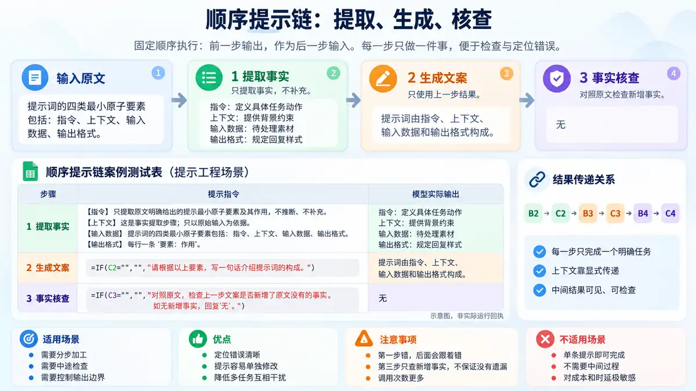
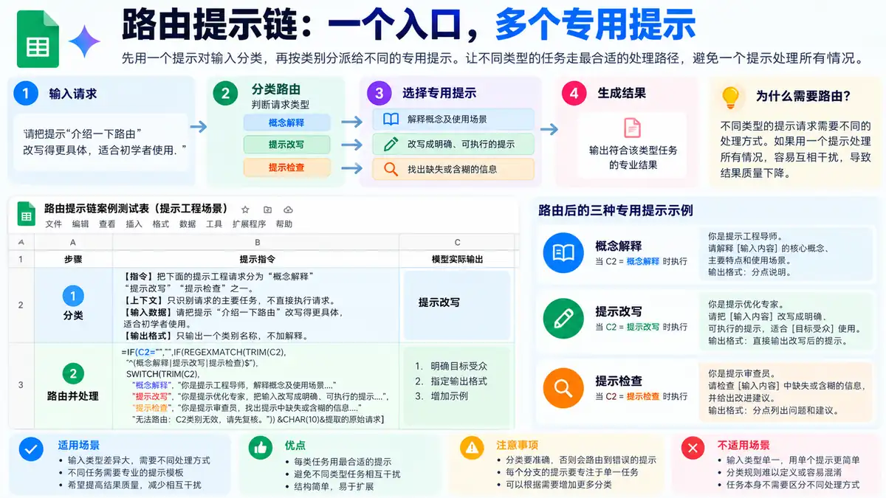
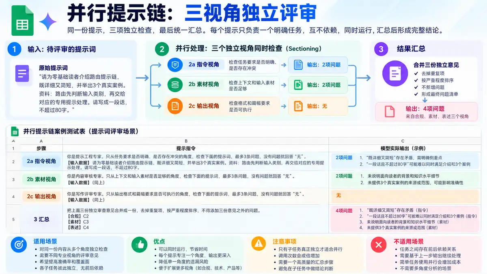
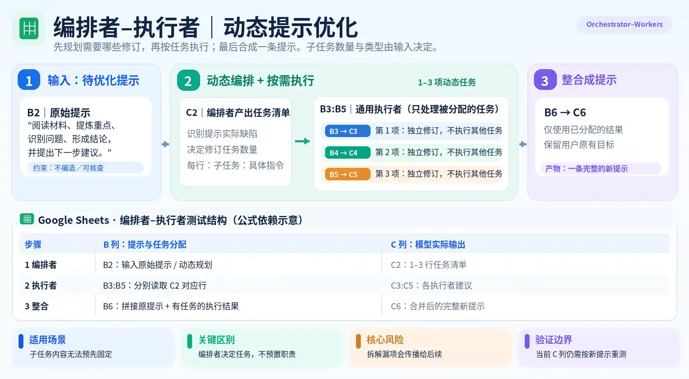

#+TITLE: 提示链案例解析
#+WIKI_ID: c596dd07-857d-4bff-b7e3-b3b9f5e1571d
#+CATEGORY: 提示工程
#+FILETAGS: :prompt-engineering:llm:gemini:google-sheets:
#+DATE: 2026-10-28
#+SOURCE: 2026-10-28 本次对话整理；Gemini Google Sheets 三步测试表尚未完成真实模型执行
#+INGEST_ID: 8f63a831-7fd2-4c17-888d-34dc896c6e8c
#+WIKI_STATUS: published

#+ATTR_HTML: :width 100%

本篇比较四种提示工作流：顺序提示链按固定步骤传递结果；路由根据输入类别选择一条处理路径；并行化让独立任务分别处理同一输入后汇总；编排者–执行者由模型现场决定子任务。每个案例都应区分提示公式、当前模型返回与是否完成有效复测。

* 工作方式

** 顺序提示链：提取、生成、核查

案例把“介绍提示词的四种基本要素”拆成三步。每条提示只完成一个任务：提取事实、生成文案、核查新增事实。提示由指令、上下文、输入数据、输出格式组成；这些是提示内部的要素，不是四次调用。

#+CAPTION: 三步提示链示意图。头图不是 Gemini 实际运行回执。
#+ATTR_HTML: :width 100%

下表直接取自 [[https://docs.google.com/spreadsheets/d/1eV1Eg9KO0aTEuhhaN2cFVPVhjwk2zclBuPeCW4eLeP8/edit][Google Sheet《提示链》]] 的「1 顺序提示链」。B 列保留原始文字或公式。调用公式是重测时填入 C 列的公式；右列是表格当前显示的历史结果，并非本次重测。

| 步骤 | B 列提示（原值） | C 列调用公式（重测用） | 当前 C 列显示值（历史） |
|------+--------------------+--------------------------+----------------------------|
| 1 提取事实 | 【指令】只提取原文明确给出的提示最小原子要素及其作用，不推断、不补充。@@html: @@【上下文】这是事实提取步骤；只以原始输入为依据。@@html: @@【输入数据】提示词的四类最小原子要素包括：指令（定义具体任务动作）、上下文（提供背景约束与角色定位）、输入数据（待处理的素材或上一步输出）、输出格式（规定回复的结构与样式）。@@html: @@【输出格式】每行一条“要素：作用”，不添加解释。 | ~=AI(B2)~ | 指令：定义具体任务动作@@html: @@上下文：提供背景约束与角色定位@@html: @@输入数据：待处理的素材或上一步输出@@html: @@输出格式：规定回复的结构与样式 |
| 2 生成文案 | ~=IF(C2="","","【指令】根据以下事实写一句30字以内的中文介绍。"&CHAR(10)&"【上下文】只使用上一步模型在C2的实际输出，不新增事实。"&CHAR(10)&"【输入数据·步骤1输出】"&CHAR(10)&C2&CHAR(10)&"【输出格式】只输出一句介绍文案。")~ | ~=AI(B3)~ | 提示词由指令、上下文、输入数据和输出格式四类最小原子要素构成，分别用于定义具体任务、提供背景约束、传递待处理内容及规定输出结构。 |
| 3 事实核查 | ~=IF(C3="","","【指令】检查文案是否包含原始输入中没有的事实。"&CHAR(10)&"【上下文】只将B2中【输入数据】的原文视为事实依据，不以C2或C3的模型判断代替原文。"&CHAR(10)&"【输入数据·原始输入（B2）】"&CHAR(10)&B2&CHAR(10)&"【输入数据·步骤2实际文案（C3）】"&CHAR(10)&C3&CHAR(10)&"【输出格式】有新增事实则逐条引用并说明；没有只输出“无”。")~ | ~=AI(B4)~ | 无 |

数据传递：=B2 → C2 → B3 → C3 → B4 → C4=。其中 =B3= 读取 =C2=，=B4= 读取 =B2= 和 =C3=。C3 当前保存的是历史文本，重测时才替换为表中的 =AI(B3)=。

** 路由提示链：分类后执行专用任务

同一类提示工程请求可能是问概念、要改写，或要检查。路由先判断请求属于哪一类，再调用对应的专用提示；不是把三种任务都执行一遍。

路由提示链示意图：说明分类后如何分流到专用提示，并非实际模型执行记录。
#+ATTR_HTML: :width 100%

下表取自同一份 [[https://docs.google.com/spreadsheets/d/1eV1Eg9KO0aTEuhhaN2cFVPVhjwk2zclBuPeCW4eLeP8/edit#gid=505281377][训练表「2 路由提示链」]] 的 =A1:C3=。C 列为读取时的显示结果，不能单凭表格内容确定模型调用时间。

| 步骤 | B 列提示 / 公式 | C 列执行公式 | 当前 C 列显示结果 |
|------+----------------------+----------------+---------------------|
| 1 分类 | 【指令】把下面的提示工程请求分为“概念解释”“提示改写”“提示检查”之一。@@html: @@【上下文】只识别请求的主要任务，不直接执行请求。@@html: @@【输入数据】请把提示“介绍一下路由”改写得更具体，适合初学者使用。@@html: @@【输出格式】只输出一个类别名称，不加解释。 | ~=AI(B2)~ | 提示改写 |
| 2 路由并处理 | 完整公式见下方 =B3= | ~=AI(B3)~ | 请用通俗易懂的语言向初学者解释“路由”的概念，重点说明它的基本定义、核心功能与工作原理[待补充]。 |

=B3= 原始公式（可复制到 Google Sheets）：

#+begin_src text
=IF(C2="","",IF(REGEXMATCH(TRIM(C2),"^(概念解释|提示改写|提示检查)$"),"【指令】"&SWITCH(TRIM(C2),"概念解释","解释用户询问的提示工程概念。","提示改写","把用户提供的提示改写成一条任务明确、可执行的新提示。","提示检查","指出用户提供的提示中缺失或含糊的关键信息。")&CHAR(10)&"【上下文】只完成当前类别的任务，不编造用户未提供的素材。"&CHAR(10)&"【输入数据·原始请求】"&TRIM(REGEXEXTRACT(B2,"【输入数据】([^\r\n]+)"))&CHAR(10)&"【输入数据·上一步分类】"&TRIM(C2)&CHAR(10)&"【输出格式】"&SWITCH(TRIM(C2),"概念解释","仅输出两句话：概念定义和一个使用场景。","提示改写","只输出改写后的提示；必要但缺失的信息用[待补充]标明。","提示检查","按编号列出最多3个具体问题，不改写提示。"),"停止路由：C2不是本案例的类别，请先重新执行=AI(B2)。"))
#+end_src

传递关系：=B2 → C2（分类）→ B3（选择专用提示）→ C3（执行结果）=。=B3= 同时读取 =B2= 中的原始请求；只提取 =【输入数据】= 后面的内容，不把上一步分类指令当成用户请求。=C2= 不属于三个预设类别时停止路由。

| C2 分类 | B3 只执行的任务 |
|---------+-----------------|
| 概念解释 | 解释概念及使用场景 |
| 提示改写 | 将原提示改成任务明确、可执行的新提示 |
| 提示检查 | 找出缺失或含糊的关键信息 |

这次读取时 =C2= 显示“提示改写”，=B3= 因此会进入改写分支。=C3= 的结果还含 = [待补充] = 占位符，不能直接认定为最终可用提示；它仍需要判断哪些信息确实缺失。C 列备注沿用旧的历史记录说明，所以这里只记录*当前显示值*，不推断其执行时间。

*适用边界*：不同输入需要不同处理方法、分类足够可靠时才值得路由。分类错会选错提示；单一任务直接用专用提示更简单。若要重新验证，在 =C2=、=C3= 依次执行表中的 =AI()= 公式，先检查分类，再检查改写结果。

** 并行提示链：三视角独立评审

下图展示三个独立评审分支及其结果汇总，不是模型运行截图。
#+ATTR_HTML: :width 100%

这是分工并行（Sectioning），不是多数投票。三个提示审查同一份输入，但职责各不相同：一条检查任务要求，一条检查上下文与素材，一条检查输出格式；三个结果齐备后才汇总。[[https://www.anthropic.com/engineering/building-effective-agents][Anthropic《Building effective agents》]]将它列为并行化的两种典型方式之一。

下表按 [[https://docs.google.com/spreadsheets/d/1eV1Eg9KO0aTEuhhaN2cFVPVhjwk2zclBuPeCW4eLeP8/edit#gid=1705115362][原测试表「3 并发提示链」]] 的 =A1:C6= 当前单元格读取。C3:C6 均为真实存在的 =AI()= 公式及其当前显示输出；C2 的“无”是普通文本，不是模型调用。原有 C 列备注沿用了旧行号，不能据此确定本轮的具体执行时间。

| 步骤 | B 列提示 / 公式 | C 列公式或类型 | 当前 C 列显示结果 |
|------+--------------------+------------------+-----------------------|
| 1 测试内容 | 【上下文】独立评审“指令”要素；不检查素材是否充分或输出格式。@@html: @@【输入数据】@@html: @@    1. 请为零基础读者介绍路由提示链，既详细又简短，并举出3个真实案例。@@html: @@    2. 资料：路由先判断输入类别，再交给对应的专用提示处理。请写成一段话，不超过80字。@@html: @@【输出格式】编号列出最多2个具体问题；没有则只输出“无”。 | 固定文本（非模型调用） | 无 |
| 2a 指令视角 | 原始公式见下方 =B3= | ~=AI(B3)~ | 1.  “既详细又简短”的要求存在矛盾冲突，难以同时满足。@@html: @@2.  要求“举出3个真实案例”与“不超过80字”的篇幅限制存在冲突，可执行性较差。 |
| 2b 素材视角 | 原始公式见下方 =B4= | ~=AI(B4)~ | 1.  输入资料仅包含一句话概要，未提供任何“3个真实案例”的素材与依据。@@html: @@2.  缺失针对“零基础读者”的浅显化解释或背景知识补充，现有资料不足以支撑详细介绍。 |
| 2c 输出视角 | 原始公式见下方 =B5= | ~=AI(B5)~ | 无 |
| 3 汇总 | 原始公式见下方 =B6= | ~=AI(B6)~ | 1.  “既详细又简短”的要求存在矛盾冲突，难以同时满足。（来源：指令视角）@@html: @@2.  要求“举出3个真实案例”与“不超过80字”的篇幅限制存在冲突，可执行性较差。（来源：指令视角）@@html: @@3.  输入资料仅包含一句话概要，未提供任何“3个真实案例”的素材与依据。（来源：素材视角）@@html: @@4.  缺失针对“零基础读者”的浅显化解释或背景知识补充，现有资料不足以支撑详细介绍。（来源：素材视角） |

=B3= 原始公式：

#+begin_src text
="【指令】只检查下面提示的任务要求是否明确、是否存在冲突。"&CHAR(10)&B2
#+end_src

=B4= 原始公式：

#+begin_src text
=IFERROR("【指令】只检查提示的读者背景和输入素材是否足以支持任务。"&CHAR(10)&"【上下文】独立评审“上下文、输入数据”要素；不检查指令冲突或输出格式。"&CHAR(10)&"【输入数据】"&REGEXEXTRACT($B$3,"(?s)【输入数据】(.*?)【输出格式】")&"【输出格式】编号列出最多2个缺失信息或依据问题；没有则只输出“无”。","")
#+end_src

=B5= 原始公式：

#+begin_src text
=IFERROR("【指令】只检查提示的输出形式和篇幅要求是否清楚、可验收。"&CHAR(10)&"【上下文】独立评审“输出格式”要素；不检查任务目标或素材依据。"&CHAR(10)&"【输入数据】"&REGEXEXTRACT($B$3,"(?s)【输入数据】(.*?)【输出格式】")&"【输出格式】编号列出最多2个格式或篇幅问题；没有则只输出“无”。","")
#+end_src

=B6= 原始公式：

#+begin_src text
=IF(OR(C3="",C4="",C5=""),"","【指令】合并三份独立提示评审意见，整理成一份修改清单。"&CHAR(10)&"【上下文】只合并、去重，不补充上游未指出的问题；意见不是已执行的修改。"&CHAR(10)&"【输入数据·指令视角（C2）】"&CHAR(10)&C3&CHAR(10)&"【输入数据·素材视角（C3）】"&CHAR(10)&C4&CHAR(10)&"【输入数据·输出视角（C4）】"&CHAR(10)&C5&CHAR(10)&"【输出格式】按优先级编号列出问题并标注来源；三份全为“无”时只输出“无”。")
#+end_src

*数据依赖*：=B2= 保存待评审提示；=B3= 生成指令视角的评审提示，=B4= 与 =B5= 从 =B3= 中提取同一段原始输入，不读取其他审查结果。=C3=、=C4=、=C5= 分别执行三个 =AI()= 调用；=B6= 等待三份结果后合并，=C6= 给出最终清单。三个审查任务可以独立执行，但表格是否真正同时计算，不能仅凭公式判断。

*结果分析*：=C3= 指出“详细又简短”和“3 个真实案例、不超过 80 字”两组要求冲突；=C4= 指出输入没有提供真实案例资料，也缺少帮助零基础读者理解的素材；=C5= 返回“无”；=C6= 汇总了前两个视角的四项问题。=C5= 的“无”并不证明输出限制合理，因为字数冲突已由 =C3= 发现。并行分工能减少单个提示的任务负担，但不会自动消除漏检。

*一处待修正的引用标签*：=B6= 实际拼接的是 =C3/C4/C5=，但提示内部仍写成“指令（C2）”“素材（C3）”“输出（C4）”。来源文字应与实际单元格一致；此处只指出问题，不修改测试表历史记录。

*使用条件*：三个检查项彼此独立、确实有必要分别审查时使用分工并行。调用次数增多；汇总只能依据上游意见，不应把漏掉的问题或未核实的判断包装成事实。

** 编排者–执行者：按实际问题动态修订提示

这一例针对“阅读材料、提炼重点、识别问题、形成结论并提出建议”的通用提示。编排者根据输入判断需要修订哪些问题，再交给最多三个通用执行者处理，最后合成新提示。这里的执行者*没有预先固定的审查职责*；三名执行者只是表格容量上限，并非每次都要执行三项任务。

下图说明动态任务分配及单元格依赖，*不是本轮 Gemini 执行截图*。

#+ATTR_HTML: :width 100%

下表逐格取自 [[https://docs.google.com/spreadsheets/d/1eV1Eg9KO0aTEuhhaN2cFVPVhjwk2zclBuPeCW4eLeP8/edit#gid=1561099394][Google Sheet「4 编排者-执行者」]] 的 =A1:C6=。虽然 =C2:C6= 保存了 =AI()= 公式及当前显示值，但返回仍对应旧版“80 字、真实案例”等要求，与新版 =B2= 不符。这里完整保留失配输出作为排查证据，*不将其计为新版测试结果*。表内只把原始换行转换为网页换行。

| 步骤 | B 列提示 / 公式 | C 列调用公式 | 当前 C 列显示结果（与新输入失配） |
|------+--------------------+------------------+----------------------------------------|
| 1 编排者 | 【指令】检查下面的原始提示，按实际缺陷动态拆成互相独立的修订任务。@@html: @@【上下文】只优化提示本身，不执行原始提示；不得预设修订类别，也不得删改原目标。最多3项，不足3项就少写。@@html: @@【输入数据】请优化这条提示：“阅读用户提供的材料，提炼重点，识别问题，形成结论并提出下一步建议。”要求：适用于不同主题；只依据给定材料；区分事实、推断与未知；输出便于逐条核查。@@html: @@【输出格式】每行一项“子任务：具体修订指令”，只输出1至3行，不编号、不解释。 | ~=AI(B2)~ | 子任务：消除“详细又简短”的逻辑矛盾并取消80字字数限制@@html: @@子任务：解除“不能查阅资料”与提供“可核实案例”的互相冲突限制@@html: @@子任务：调整案例数量与篇幅要求，以适配表格呈现形式 |
| 2a 执行者1 | 原始公式见下方 =B3= | ~=AI(B3)~ | 问题：原始提示存在“详细又简短”的表述矛盾，且80字的篇幅限制无法容纳4个概念的解释与8个案例；修改建议：对解释深度提供取舍选项（选择“详细”或“简短”）[待确认]，并取消80字的字数限制。 |
| 2b 执行者2 | 原始公式见下方 =B4= | ~=AI(B4)~ | 问题：原始提示要求提供“可核实的真实案例”，但同时限制“不能查阅资料”，两者存在逻辑冲突；修改建议：对冲突条件提供取舍选项（选择“允许查阅资料以提供可核实案例”或“移除‘可核实’要求以配合禁止查阅资料”）[待确认]。 |
| 2c 执行者3 | 原始公式见下方 =B5= | ~=AI(B5)~ | 问题：原始提示要求的案例数量与篇幅限制难以同时适配表格呈现形式；修改建议：对案例数量与篇幅限制提供取舍选项（选择“减少每种概念的案例数量”或“放宽篇幅限制以完整适配表格呈现”）[待确认]。 |
| 3 整合 | 原始公式见下方 =B6= | ~=AI(B6)~ | 阅读用户提供的材料，提炼重点，识别问题，形成结论并提出下一步建议。@@html: @@@@html: @@要求：1.  适用于不同主题；@@html: @@2.  仅依据给定材料（或允许查阅资料以提供可核实案例\[待确认\]）；@@html: @@3.  区分事实、推断与未知；@@html: @@4.  输出便于逐条核查；@@html: @@5.  解释深度提供取舍选项（选择“详细”或“简短”）\[待确认\]，取消80字字数限制；@@html: @@6.  适配表格呈现形式（选择“减少案例数量”或“放宽篇幅限制”）\[待确认\]。 |

=B3= 原始公式：

#+begin_src text
=IFERROR(IF(C2="","","【指令】仅处理编排者分配的这一项提示修订任务。"&CHAR(10)&"【上下文】保留原任务目标、事实边界和输出要求；只处理本项，不改动其他任务。原文未说明的条件用[待确认]标明，不自行补造。"&CHAR(10)&"【输入数据·原始提示】"&TRIM(REGEXEXTRACT($B$2,"【输入数据】([^\r\n]+)"))&CHAR(10)&"【输入数据·分配任务】"&INDEX(SPLIT(TRIM(C2),CHAR(10)),1,1)&CHAR(10)&"【输出格式】只输出“问题：……；修改建议：……”，不生成整份新提示。"),"")
#+end_src

=B4= 原始公式：

#+begin_src text
=IFERROR(IF(C2="","","【指令】仅处理编排者分配的这一项提示修订任务。"&CHAR(10)&"【上下文】保留原任务目标、事实边界和输出要求；只处理本项，不改动其他任务。原文未说明的条件用[待确认]标明，不自行补造。"&CHAR(10)&"【输入数据·原始提示】"&TRIM(REGEXEXTRACT($B$2,"【输入数据】([^\r\n]+)"))&CHAR(10)&"【输入数据·分配任务】"&INDEX(SPLIT(TRIM(C2),CHAR(10)),1,2)&CHAR(10)&"【输出格式】只输出“问题：……；修改建议：……”，不生成整份新提示。"),"")
#+end_src

=B5= 原始公式：

#+begin_src text
=IFERROR(IF(C2="","","【指令】仅处理编排者分配的这一项提示修订任务。"&CHAR(10)&"【上下文】保留原任务目标、事实边界和输出要求；只处理本项，不改动其他任务。原文未说明的条件用[待确认]标明，不自行补造。"&CHAR(10)&"【输入数据·原始提示】"&TRIM(REGEXEXTRACT($B$2,"【输入数据】([^\r\n]+)"))&CHAR(10)&"【输入数据·分配任务】"&INDEX(SPLIT(TRIM(C2),CHAR(10)),1,3)&CHAR(10)&"【输出格式】只输出“问题：……；修改建议：……”，不生成整份新提示。"),"")
#+end_src

=B6= 原始公式：

#+begin_src text
=IFERROR(IF(OR(C2="",C3="",COUNTA(SPLIT(TRIM(C2),CHAR(10)))>3,AND(IFERROR(INDEX(SPLIT(TRIM(C2),CHAR(10)),1,2),"")<>"",C4=""),AND(IFERROR(INDEX(SPLIT(TRIM(C2),CHAR(10)),1,3),"")<>"",C5="")),"","【指令】根据各执行者的修订建议，整合成一条完整、可复用的新提示。"&CHAR(10)&"【上下文】保留原任务目标与约束，不添加原文没有的任务或事实；冲突或关键缺失未解决时保留[待确认]，不擅自替用户选择。"&CHAR(10)&"【输入数据·原始提示】"&TRIM(REGEXEXTRACT($B$2,"【输入数据】([^\r\n]+)"))&CHAR(10)&IF(IFERROR(INDEX(SPLIT(TRIM(C2),CHAR(10)),1,1),"")<>"","【子任务1】"&CHAR(10)&IFERROR(INDEX(SPLIT(TRIM(C2),CHAR(10)),1,1),"")&CHAR(10)&C3&CHAR(10),"")&IF(IFERROR(INDEX(SPLIT(TRIM(C2),CHAR(10)),1,2),"")<>"","【子任务2】"&CHAR(10)&IFERROR(INDEX(SPLIT(TRIM(C2),CHAR(10)),1,2),"")&CHAR(10)&C4&CHAR(10),"")&IF(IFERROR(INDEX(SPLIT(TRIM(C2),CHAR(10)),1,3),"")<>"","【子任务3】"&CHAR(10)&IFERROR(INDEX(SPLIT(TRIM(C2),CHAR(10)),1,3),"")&CHAR(10)&C5&CHAR(10),"")&"【输出格式】只输出修订后的完整提示；如有[待确认]，在相应位置保留。"),"")
#+end_src

*输入与传递*：=B2= 提供原始提示并要求动态输出1至3条修订任务，=C2= 接收任务清单。=B3:B5= 分别读取 =C2= 第1、2、3行，且均携带 =B2= 的原始输入；没有分配到任务的执行者返回空提示。=B6= 等待已分配任务对应的 =C3:C5= 结果，随后交给 =C6= 整合。若要真正并行运行多个执行者，仍取决于实际调用方式，不能仅由公式推断并发。

*实际结果及问题*：当前 =C2= 仍输出“详细又简短、80字限制、真实案例”等旧案例任务，而新版 =B2= 不包含这些要求。=C3:C5= 沿着旧任务继续生成修改建议；=C6= 虽提到了新版提示的通用分析目标，却又增加“案例数量、字数限制、查阅资料”等旧约束，构成明显的上游结果污染。公式能计算并不证明链路已对新输入正确执行，也无法从单元格判断真实执行时间。

*结论*：本例已具备“动态拆分 → 按需执行 → 整合”的公式结构，但仍未完成针对新版原始提示的可信实测。编排者若拆错任务，后续执行者即使严格照做，也会放大偏差；整合者不能用流畅的最终文本掩盖错误来源。表格最多容纳3项子任务，不能据此声称支持任意数量的任务。

*复测顺序*：保留历史值后，先重新执行 =C2= 的 =AI(B2)=；确认任务真正对应新版材料，再对有分配任务的执行者执行 =C3:C5=；最后执行 =C6= 的 =AI(B6)=。核对原始目标是否完整保留、是否区分事实与推断、是否出现未经要求的内容。若 =C2= 继续返回旧任务，应停止，不继续调用下游。

* 真正有用的地方

- *固定顺序与动态分工不同*：顺序链规定每一步；路由按类别选路径；并行化执行预先设定的独立任务；编排者–执行者由模型根据输入决定子任务。不能把四者都称为“三步顺序执行”。
- *传递关系能检查*：应分别核对原始输入、每一步实际返回以及下游引用。公式能够计算，不代表模型使用了本轮正确的上下文。
- *核查存在边界*：顺序链第三步只检查新增事实，不自动发现遗漏；并行汇总不修复上游漏检；编排者拆错任务会把偏差传给执行者。

* 如何验证

先备份各页 C 列的已有返回。逐页验证，不跨页复用单元格编号：

1. *顺序提示链*：按 =C2 → C3 → C4= 依次执行，核对事实提取、文案、原文对照。=C4= 返回“无”不代表没有遗漏。
2. *路由提示链*：先执行 =C2= 分类，确认属于预设三类后再执行 =C3=；核对 =B3= 是否选中正确的专用任务。
3. *并行提示链*：=C3=、=C4=、=C5= 独立执行，全部完成后再执行 =C6= 汇总；核对三份独立意见及最终清单，不能仅凭表格公式认定调用确实同时发生。
4. *编排者–执行者*：先重新执行 =C2=。若任务清单仍出现新原始提示中不存在的“80 字、真实案例”等要求，立即停止；否则仅运行已分配的 =C3:C5= 执行者，最后执行 =C6=，检查是否完整保留原目标且没有额外要求。

每一步都应保留本轮模型返回以供复核。若输出与输入失配，不能用后续整合结果掩盖问题。

* 当前测试状态

- *顺序提示链*：C 列保留历史结果；尚无本轮新版提示按顺序完整复测的证据。
- *路由提示链*：当前分类为“提示改写”，输出仍带 =[待补充]=；缺少明确的本轮执行时间记录。
- *并行提示链*：=C3:C6= 有 =AI()= 公式和可读取返回，三视角最终合并四项问题；仅能确认当前显示值，不能证明实际并发或本轮执行时间。
- *编排者–执行者*：=C2:C6= 虽有 =AI()= 公式，但返回包含与新版输入无关的旧要求，*本轮验证未通过*；应先重跑编排者，再决定是否执行下游。

网页发布成功只证明文章已经部署，不等于各案例的模型测试成功。

Google 官方说明：[[https://support.google.com/docs/answer/15877199?hl=zh-CN][在 Google Sheets 中使用 AI 函数]]。
