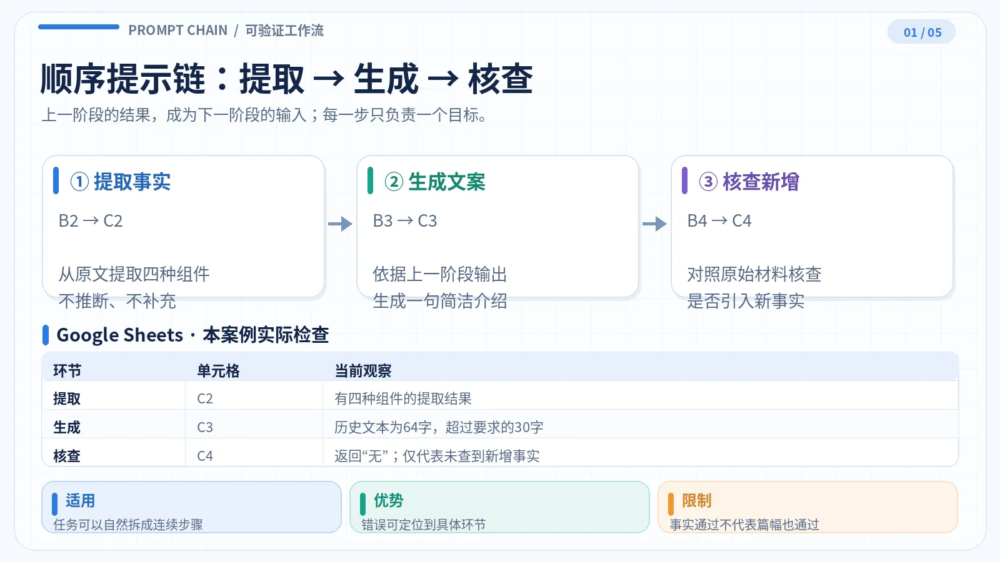
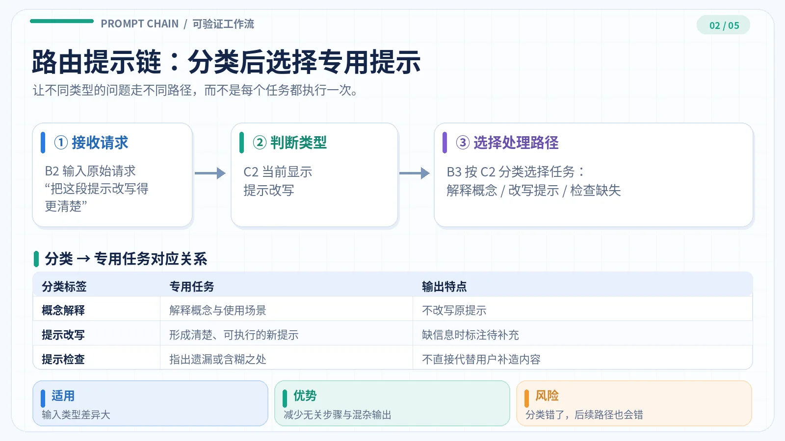
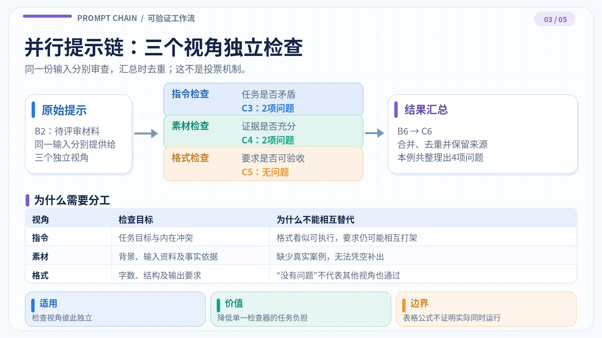
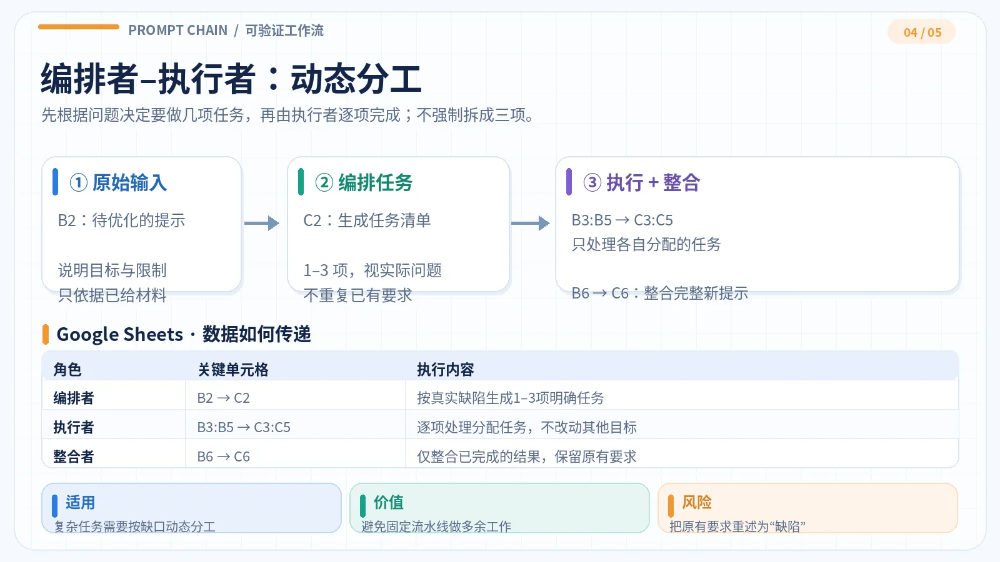

#+TITLE: 提示链案例解析
#+WIKI_ID: c596dd07-857d-4bff-b7e3-b3b9f5e1571d
#+CATEGORY: 提示工程
#+FILETAGS: :prompt-engineering:llm:gemini:google-sheets:
#+DATE: 2026-10-28
#+SOURCE: Google Sheets《提示链》五个工作表的已保存提示、结果和备注；2026-11-08核对。本文修订未触发新的Gemini执行
#+INGEST_ID: 8f63a831-7fd2-4c17-888d-34dc896c6e8c
#+WIKI_STATUS: published

#+ATTR_HTML: :width 100%

提示链要解决的是*任务组织与结果验收*，不是靠增加模型调用次数提高答案质量。固定步骤适合顺序链；输入类别不同用路由；审查维度独立用并行；任务缺口无法预先确定用编排；需要按失败证据修正时用评估–优化。这里讨论的是可检查的工作流，不是无限自主运行的智能体。[[https://www.anthropic.com/engineering/building-effective-agents][参见 Anthropic 对五类工作流的定义]]。

本文以 [[https://docs.google.com/spreadsheets/d/1eV1Eg9KO0aTEuhhaN2cFVPVhjwk2zclBuPeCW4eLeP8/edit][Google Sheets《提示链》]] 当前保存的五个案例为证据。*每节均区分实际显示结果、可成立的判断和建议的修正示例*。文中没有重新运行 Gemini；单元格里有 =AI()= 公式，不意味着它刚刚被调用，也不能把评估器的自评算成独立测试。

#+CAPTION: 五种工作流的使用条件与本例验收结论
| 工作流 | 适用条件 | 本例真正发现的问题 |
|--------+----------+--------------------|
| 顺序提示链 | 下一步依赖上一步结果 | 最终只查事实，没有核对30字上限 |
| 路由提示链 | 不同输入需要不同处理路径 | 分类正确，但改写结果仍留有占位符 |
| 并行提示链 | 检查维度相对独立 | 汇总只合并，不能补救跨维度漏检 |
| 编排者–执行者 | 不确定需要拆出哪些子任务 | 把原文已有要求当作新缺口 |
| 评估者–优化者 | 有明确失败项，需修订并复核 | 初稿符合现有规则，但无有效优化轮次证据 |

* 五个案例：从机制到证据

** 顺序提示链：提取、生成、核查

*目标*：根据材料写一段不超过30字的提示词介绍，且不能增加材料没有的事实。三个步骤有严格依赖，后一步应使用前一步的输出，而不是重新猜测材料。

#+CAPTION: 顺序链的事实提取、文案生成和事实核查
#+ATTR_HTML: :width 100%

原输入列出四类要素：指令、上下文、输入数据、输出格式。执行关系是 =B2 → C2 → B3 → C3 → B4 → C4=。

#+CAPTION: 顺序提示链的实有单元格与验收
| 位置 | 工作表当前记录 | 结论 |
|------+----------------+------|
| =C2= | 四类要素及各自作用 | 形成写作依据；未验证所有语义边界 |
| =C3= | 一句介绍，64字符 | 超过 =B3= 的30字上限 |
| =C4= | “无” | 只表示模型未报告新增事实 |

=C3= 原文：“提示词由指令、上下文、输入数据和输出格式四类最小原子要素构成，分别用于定义具体任务、提供背景约束、传递待处理内容及规定输出结构。”

*原因*：=B4= 只让模型核对新增事实，所以 =C4= 返回“无”并不等于全部合格。这是*验收条件覆盖不完整*，而不是证明顺序链的传递机制失效。此外 =C3= 保存的是历史文本，不能推断其生成时间。

*修订后的完整文案（本文人工编写，不是 =C3= 新输出）*：“提示由指令、上下文、输入数据和输出格式构成。”共22个字符，保留了原材料的四个类别名称，满足“30字以内、只输出一句”的形式要求。

*最小复测*：用 ~LEN(C3)<=30~ 检查字符数；逐项对照 =B2= 核验四类要素是否准确；确认 =C3= 只有一句、没有新增事实。=B4= 继续负责事实核查，新增的字数规则负责长度校验，避免把两种检查混为一个结论。来源：[[https://docs.google.com/spreadsheets/d/1eV1Eg9KO0aTEuhhaN2cFVPVhjwk2zclBuPeCW4eLeP8/edit#gid=1602514994][1 顺序提示链]]（=A2:C4=）；原始公式见附录。

** 路由提示链：先分类，再执行专用任务

*目标*：将“解释概念、改写提示、检查提示”分开处理，防止一条通用提示把不同任务混在一起。=C2= 负责分类；=B3= 用 =SWITCH= 选择分支、带入原请求；=C3= 给出该分支的实际结果。

#+CAPTION: 识别请求类别后只走对应分支
#+ATTR_HTML: :width 100%

原始请求：“请把提示‘介绍一下路由’改写得更具体，适合初学者使用。”

#+CAPTION: 路由分类与改写结果的核验
| 位置 | 实际显示 | 判断 |
|------+----------+------|
| =C2= | “提示改写” | 与主要任务相符 |
| =B3= | 进入“提示改写”专用指令 | 分类结果已用于选择分支 |
| =C3= | “请用通俗易懂的语言向初学者解释‘路由’的概念，重点说明它的基本定义、核心功能与工作原理[待补充]。” | 留有未指明缺什么的占位符 |

*原因*：原始请求已经提供动作（改写提示）、主题（路由）和读者（初学者）；在提示工程语境下，足以生成一条可执行的解释提示。=C3= 末尾的 =[待补充]= 没有标明缺少哪项信息，属于不必要的占位符，应删除。=C2= 分类正确，但 =C3= 未完成交付检查。

*可直接使用的改写提示（本文人工编写，非 =C3= 新输出）*：

#+begin_example
请向零基础读者解释提示工程中的“路由”。
先用一句话定义，再举一个示例：用户请求被识别为
“概念解释、提示改写、提示检查”之一，分别交给对应的专用提示处理。
最后说明分类错误会造成什么后果。只用普通话，避免未解释的术语。
#+end_example

*最小复测*：分别使用“解释路由是什么”“把介绍路由的提示改得更明确”“检查这条路由提示是否含糊”验证三个分支；再提供无法归类的请求，验证停止条件。这四个是新增的*测试设计*，不是当前表格的已执行结果。原 =B3= 仅抽取“输入数据”标签之后的一行；跨行请求会丢失后续内容。可将提取部分改为 ~REGEXEXTRACT(B2,"(?s)【输入数据】(.*?)【输出格式】")~，按明确的区块边界截取多行输入。修改方案尚未写入 Google Sheets。来源：[[https://docs.google.com/spreadsheets/d/1eV1Eg9KO0aTEuhhaN2cFVPVhjwk2zclBuPeCW4eLeP8/edit#gid=505281377][2 路由提示链]]（=A2:C3=）。

** 并行提示链：独立审查，不能只拼接意见

*目标*：同一份提示分别交给指令、素材、输出三个评估视角，再合并结果。它属于*分工并行（sectioning）*，不是把同题回答三遍做多数投票；表格的独立公式不证明这些 =AI()= 在时间上同时执行。

#+CAPTION: 三个审查视角分别出结果，最后统一汇总
#+ATTR_HTML: :width 100%

原任务要求面向零基础读者介绍路由提示链，“详细又简短”，附3个真实案例，且不超过80字；输入材料却只提供了一句路由定义。

#+CAPTION: 三视角评估的实际记录
| 视角 | 工作表显示 | 可以得出的结论 |
|------+------------+----------------|
| 指令 =C3= | 指出“详细又简短”不易验收；3个案例与80字要求存在张力 | 发现要求不明确及潜在冲突 |
| 素材 =C4= | 指出没有真实案例依据、缺少入门资料 | 现有材料不足以证明案例真实性 |
| 输出 =C5= | “无” | 本视角没有报告格式问题 |
| 汇总 =C6= | 合并前两个视角的4项意见，注明来源 | 汇总没有补充未识别的交叉问题 |

*原因*：=C5= 返回“无”符合它被限定的检查职责：80字上限本身清楚、可测。真正缺失的是*跨视角的联合检查*——能否同时讲清楚概念、提供有出处的三个例子，并满足长度要求。=B6= 被限定为只合并、不新增意见，所以它无法发现或修复联合约束问题。

不能简单宣称“3个案例加定义绝对超过80字”——短例可能装得下；真正确定的缺口是*没有可核实的真实案例材料*。在获得案例来源前，生成器不应编造它们。

*补全缺失素材（来自官方文档，不是本表的 Gemini 输出）*：[[https://www.anthropic.com/engineering/building-effective-agents][Anthropic《Building effective agents》]]明确举出了客服路由的三类典型请求：普通咨询、退款申请、技术支持。三者分别进入知识答复、退款处理和技术排障分支。这是*官方文档的示例场景*，不能改称已核实的三个生产事故或客户案例。

*完整修订提示（本文提出，尚未回填表格）*：

#+begin_example
向零基础读者解释路由提示链：先定义“根据请求类别选择专用处理路径”，
再用三个客服场景说明：普通咨询→知识答复、退款申请→退款处理、
技术问题→排障。说明这些是文档示例，而非已验证的生产案例。
写成一段话，字数不超过150字；不得编造实施效果。
#+end_example

原题要求“三个真实案例”，但没有提供真实实施记录；这里选择*改为三个有出处的示例场景*，并将字数上限调整为150字。这是明确修改任务约束的示范，不是对原80字要求已通过的证明。建议保留三个评估分支，汇总后增加联合检查，分别核对任务、材料和输出条件能否同时满足。

*最小复测*：对上面的修订提示生成一次内容，用 ~LEN(输出单元格)<=150~ 检查字数，逐项核对三种场景均来自官方文档，再与原80字要求做对照。这是新任务的验收设计，未改动工作表的历史输入或输出。来源：[[https://docs.google.com/spreadsheets/d/1eV1Eg9KO0aTEuhhaN2cFVPVhjwk2zclBuPeCW4eLeP8/edit#gid=1705115362][3 并发提示链]]（=A2:C6=）。

** 编排者–执行者：先证明有缺口，再分配任务

*目标*：当输入需要怎样修改事先无法确定时，由编排者决定拆分哪些子任务；执行者分别处理；最后整合。它与并行链的区别是：*并行链预设审查维度，编排链按具体输入动态决定任务*。

#+CAPTION: 编排者识别必要子任务，执行者独立处理并整合
#+ATTR_HTML: :width 100%

待优化的原提示要求：阅读给定材料、提炼重点、识别问题、形成结论并建议下一步；还明确规定“只依据材料、区分事实／推断／未知、输出可逐条核查”。

#+CAPTION: 编排者的三项分工是否必要
| =C2= 分配的任务 | 原提示已有内容 | 判断 |
|----------------+----------------+------|
| 禁止材料外假设 | 已规定只依据给定材料 | 主要是重复并加强原要求 |
| 区分事实、推断、未知 | 已明确提出 | 重复原要求，可补充标记方法 |
| 明确可核查的输出结构 | 只提出“可逐条核查” | 属于真实的操作细节缺口 |

=C3:C5= 对三个任务分别提出建议，=C6= 整合为完整提示。这证明工作表有分工和整合结果，*不能证明三项分工都必要*。尤其要避免将“不添加材料外事实”扩大成“不允许基于材料作有依据的推断”。

*编排指令与完整交付示范（本文人工编写，未作为 Gemini 输出）*：

#+begin_example
编排阶段：只提出原提示尚未说明、会影响执行的修订点。
逐项给出“原文缺口→影响→补充要求”；已明确的条件不得重复分配。
没有实质缺口时输出“无需修订”，停止创建执行者任务。
#+end_example

本案例真正缺少的是逐条核查的*操作规范*。可以将原提示补充为：

#+begin_example
阅读用户提供的材料，提炼重点、识别问题、形成结论并建议下一步。
只使用给定材料，不添加材料外事实。按以下结构作答：
1. 事实：列出可核查的原文信息，并标注对应依据。
2. 推断：写出由哪些事实推得结论，不能将推断冒充事实。
3. 未知：列出材料未提供、但会影响判断的关键内容。
4. 建议：按优先级列出下一步动作及需要核查的证据。
#+end_example

对于当前输入，优先补的是“怎么呈现可逐条核查的证据”，而不是重新发明事实与推断的分类要求。*最小复测*：先人工核查 =C2= 的每个缺口，再检查 =C3:C5= 是否只解决分配项、=C6= 是否保留原任务；如果 =C2= 没有有效任务，应允许不启动执行者。来源：[[https://docs.google.com/spreadsheets/d/1eV1Eg9KO0aTEuhhaN2cFVPVhjwk2zclBuPeCW4eLeP8/edit#gid=1561099394][4 编排者-执行者]]（=A2:C6=）。

** 评估者–优化者：有失败证据才修订

*目标*：先交付初稿，再按验收标准评估。通过就停止；确有失败才改，修订后用同一案例复评，最多两轮。反复写“再优化一下”却不给失败证据，不构成有效优化。

#+CAPTION: 初稿、评估、门控与最多两次条件修订；示意图不代表真实修订次数
#+ATTR_HTML: :width 100%

本例不是撰写完整文章，而是为提示的四个组成部分各写一条“是／否”判断问题。任务与规则在 =B2:B7=；六个输入及预期在 =B25:C30=；=B12:C17= 依次承载生成、评估与条件修订。

=C12= 当前保存的初稿：

#+begin_example
指令：该片段是否在要求AI执行特定动作或任务？
上下文：该片段是否仅提供背景信息而非待加工材料？
输入数据：该片段是否包含需要AI处理或转换的实际文本材料？
输出格式：该片段是否对回答的排版结构或字数做出硬性要求？
#+end_example

#+CAPTION: 六项固定案例的预期及评估器实际记录
| 案例 | 预期的处理方式 | =C13= 当前记录 |
|------+----------------+----------------|
| 请分析以下材料： | 指令；“以下材料”只是指代 | 推演符合 |
| 请用表格列出结论。 | 拆成指令与输出格式 | 推演符合 |
| 以下数据仅供理解背景。 | 上下文 | 推演符合 |
| 答案不得超过100字。 | 输出格式中的篇幅限制 | 推演符合 |
| 请提炼下面文字的观点：今天下雨了。 | 指令与待加工文字 | 推演符合 |
| 请把下文整理成三条：苹果、梨、桃。 | 指令、输出数量、待加工材料 | 推演符合 |

=C13= 是评估模型对初稿规则的*逐例推演*，不是把六条输入交给独立分类器进行实测。六条“符合”不能当作真实分类准确率。

#+CAPTION: 判定修订是否真实发生的关键证据
| 单元格 | 工作表显示 | 证据能支持什么 |
|--------+------------+----------------|
| =C19= | 4行、最长29字、禁词与标签均通过 | 初稿符合确定性格式规则 |
| =B9= | “初稿通过（仍需人工确认）” | 按现有门控规则应该停止 |
| =B14/B16= | 两个修订提示均为空 | 没有失败触发修订的证据 |
| =C14/C16= | 仍显示与初稿一样的文本 | 不能证明发生两轮有效修改 |
| =C15/C17= | 均写“通过” | 不能作为质量提升的独立证据 |

*已定位的语义缺口*：=C12= 的输入数据判断题只写“实际文本材料”，因此遗漏了本次需要处理的图片、音频等非文本材料；输出格式判断题只写“硬性要求”，因此遗漏“如方便请用要点回答”这类非强制形式偏好。=C19= 只检查行数、字数、禁词和标签，不会发现这两项定义覆盖不足。=C13= 的六例均未涉及这些边界，所以“推演符合”不能证明分类规则完整。

*补全后的四个判断问题（本文重新拟定，未回填工作表）*：

#+begin_example
指令：该片段是否要求模型执行或避免某项操作？
上下文：该片段是否提供无需加工的背景？
输入数据：该片段是否是本次需要处理的材料？
输出格式：该片段是否对答案形式、结构或篇幅提出要求？
#+end_example

四行依次为指定标签，均能回答是／否，每行均不超过30个字符，且不含任务禁止的词。先拆分复合句，再判别各片段；“请描述上传图片”中的图片是待处理材料，“如方便请用要点回答”中的要点方式属于输出形式要求。此处属于对规则文本的静态检查，*不是 Gemini 分类测试结果*。

*复测方法（待执行）*：保存旧结果；把新增边界案例单独列入测试；用分类规则实际逐条分类；对照人工预期记录失败项；只有确有失败才启动 =C14= 修订，再复测原六例和新增案例。若结果未变好，应写明失败原因而不是报告“优化成功”。正式效果评估应有独立于优化过程的样本。[[https://platform.claude.com/docs/en/test-and-evaluate/define-success][参见 Anthropic 的可测验收标准与评估设计原则]]。

*本次结论*：=C19= 已通过四行格式检查，=C13= 对原六例给出推演“符合”；=B14/B16= 均为空，因此没有触发可核查的修订轮次。已有结果不能计算分类准确率，也不能称为两轮优化后的改进。来源：[[https://docs.google.com/spreadsheets/d/1eV1Eg9KO0aTEuhhaN2cFVPVhjwk2zclBuPeCW4eLeP8/edit#gid=1601660155][5 评估者-优化者]]（=B2:C33=）。

* 怎样验收一条提示链

五种模式选型不同，但验收应遵守同一个原则：*改的是实际失败点，验证的是完整任务，而不只是模型给出的“通过”字样*。

#+CAPTION: 每种模式需要额外验证的关键条件
| 模式 | 最小验收条件 | 失败后优先检查 |
|------+--------------+----------------|
| 顺序 | 每步输出可追踪；事实、格式、篇幅逐项合格 | 是否遗漏硬约束 |
| 路由 | 分支类别正确；结果符合原任务；异常类别可停止 | 分类、原始输入是否丢失 |
| 并行 | 每份意见有依据；汇总兼顾跨维度约束 | 上游漏检、观点间是否冲突 |
| 编排 | 每个子任务确有新缺口；最终结果保留原目标 | 是否重复拆分、执行越界 |
| 评估–优化 | 有明确失败→有实际差异→回归后改善 | 缺失败证据、旧输出残留 |

建议每轮保留五项记录：*输入与验收标准、公式或提示版本、模型原始输出、检查依据、修订前后差异*。对于能写成规则的条件（行数、字数、禁词），优先用程序验证；对于事实准确性与复杂语义，用明确证据和人工复核；最后用未参与优化的边界案例检查泛化能力。

文章中的“修订示范”均为人工提供的*待测方案*，没有回填表格或冒充 Gemini 输出。文末附录保存原始公式，复测前请与工作表当前公式再次核对。原始工作流方法见[[https://www.anthropic.com/engineering/building-effective-agents][Anthropic《Building effective agents》]]，评估原则见[[https://platform.claude.com/docs/en/test-and-evaluate/define-success][Claude Platform《Define success criteria and build evaluations》]]。

* 附录：可复现的原始公式

以下公式按压缩前版本（[[https://github.com/lovemoganna/org-notes/blob/4eb71a33d0e84edfbba608955656ea0ff1e71c24/notes/knowledge/prompt-engineering/c596dd07-857d-4bff-b7e3-b3b9f5e1571d.org][原始文章快照]]）逐字保留。它们是*原记录*，不是本轮新执行的结果。每次复测应先在 [[https://docs.google.com/spreadsheets/d/1eV1Eg9KO0aTEuhhaN2cFVPVhjwk2zclBuPeCW4eLeP8/edit][工作簿]] 核对单元格的最新值，避免用旧公式覆盖后续修改。

*** 顺序提示链：=B3/B4=

*原始公式* =B3=：生成文案

#+begin_src text
=IF(C2="","","【指令】根据以下事实写一句30字以内的中文介绍。"&CHAR(10)&"【上下文】只使用上一步模型在C2的实际输出，不新增事实。"&CHAR(10)&"【输入数据·步骤1输出】"&CHAR(10)&C2&CHAR(10)&"【输出格式】只输出一句介绍文案。")
#+end_src

*原始公式* =B4=：事实核查

#+begin_src text
=IF(C3="","","【指令】检查文案是否包含原始输入中没有的事实。"&CHAR(10)&"【上下文】只将B2中【输入数据】的原文视为事实依据，不以C2或C3的模型判断代替原文。"&CHAR(10)&"【输入数据·原始输入（B2）】"&CHAR(10)&B2&CHAR(10)&"【输入数据·步骤2实际文案（C3）】"&CHAR(10)&C3&CHAR(10)&"【输出格式】有新增事实则逐条引用并说明；没有只输出“无”。")
#+end_src

*** 路由提示链：=B3=

*原始公式* =B3=

#+begin_src text
=IF(C2="","",IF(REGEXMATCH(TRIM(C2),"^(概念解释|提示改写|提示检查)$"),"【指令】"&SWITCH(TRIM(C2),"概念解释","解释用户询问的提示工程概念。","提示改写","把用户提供的提示改写成一条任务明确、可执行的新提示。","提示检查","指出用户提供的提示中缺失或含糊的关键信息。")&CHAR(10)&"【上下文】只完成当前类别的任务，不编造用户未提供的素材。"&CHAR(10)&"【输入数据·原始请求】"&TRIM(REGEXEXTRACT(B2,"【输入数据】([^\r\n]+)"))&CHAR(10)&"【输入数据·上一步分类】"&TRIM(C2)&CHAR(10)&"【输出格式】"&SWITCH(TRIM(C2),"概念解释","仅输出两句话：概念定义和一个使用场景。","提示改写","只输出改写后的提示；必要但缺失的信息用[待补充]标明。","提示检查","按编号列出最多3个具体问题，不改写提示。"),"停止路由：C2不是本案例的类别，请先重新执行=AI(B2)。"))
#+end_src

*** 并行提示链：=B3:B6=

*原始公式* =B3=

#+begin_src text
="【指令】只检查下面提示的任务要求是否明确、是否存在冲突。"&CHAR(10)&B2
#+end_src

*原始公式* =B4=

#+begin_src text
=IFERROR("【指令】只检查提示的读者背景和输入素材是否足以支持任务。"&CHAR(10)&"【上下文】独立评审“上下文、输入数据”要素；不检查指令冲突或输出格式。"&CHAR(10)&"【输入数据】"&TRIM(REGEXEXTRACT($B$2,"(?s)【输入数据】(.*?)【输出格式】"))&CHAR(10)&"【输出格式】编号列出最多2个缺失信息或依据问题；没有则只输出“无”。","")
#+end_src

*原始公式* =B5=

#+begin_src text
=IFERROR("【指令】只检查提示的输出形式和篇幅要求是否清楚、可验收。"&CHAR(10)&"【上下文】独立评审“输出格式”要素；不检查任务目标或素材依据。"&CHAR(10)&"【输入数据】"&TRIM(REGEXEXTRACT($B$2,"(?s)【输入数据】(.*?)【输出格式】"))&CHAR(10)&"【输出格式】编号列出最多2个格式或篇幅问题；没有则只输出“无”。","")
#+end_src

*原始公式* =B6=

#+begin_src text
=IF(OR(C3="",C4="",C5=""),"","【指令】合并三份独立提示评审意见，整理成一份修改清单。"&CHAR(10)&"【上下文】只合并、去重，不补充上游未指出的问题；意见不是已执行的修改。"&CHAR(10)&"【输入数据·指令视角（C3）】"&CHAR(10)&C3&CHAR(10)&"【输入数据·素材视角（C4）】"&CHAR(10)&C4&CHAR(10)&"【输入数据·输出视角（C5）】"&CHAR(10)&C5&CHAR(10)&"【输出格式】按优先级编号列出问题并标注来源；三份全为“无”时只输出“无”。")
#+end_src

*** 编排者–执行者：=B3:B6=

*原始公式* =B3=

#+begin_src text
=IFERROR(IF(C2="","","【指令】仅处理编排者分配的这一项提示修订任务。"&CHAR(10)&"【上下文】保留原任务目标、事实边界和输出要求；只处理本项，不改动其他任务。原文未说明的条件用[待确认]标明，不自行补造。"&CHAR(10)&"【输入数据·原始提示】"&TRIM(REGEXEXTRACT($B$2,"【输入数据】([^\r\n]+)"))&CHAR(10)&"【输入数据·分配任务】"&INDEX(SPLIT(TRIM(C2),CHAR(10)),1,1)&CHAR(10)&"【输出格式】只输出“问题：……；修改建议：……”，不生成整份新提示。"),"")
#+end_src

*原始公式* =B4=

#+begin_src text
=IFERROR(IF(C2="","","【指令】仅处理编排者分配的这一项提示修订任务。"&CHAR(10)&"【上下文】保留原任务目标、事实边界和输出要求；只处理本项，不改动其他任务。原文未说明的条件用[待确认]标明，不自行补造。"&CHAR(10)&"【输入数据·原始提示】"&TRIM(REGEXEXTRACT($B$2,"【输入数据】([^\r\n]+)"))&CHAR(10)&"【输入数据·分配任务】"&INDEX(SPLIT(TRIM(C2),CHAR(10)),1,2)&CHAR(10)&"【输出格式】只输出“问题：……；修改建议：……”，不生成整份新提示。"),"")
#+end_src

*原始公式* =B5=

#+begin_src text
=IFERROR(IF(C2="","","【指令】仅处理编排者分配的这一项提示修订任务。"&CHAR(10)&"【上下文】保留原任务目标、事实边界和输出要求；只处理本项，不改动其他任务。原文未说明的条件用[待确认]标明，不自行补造。"&CHAR(10)&"【输入数据·原始提示】"&TRIM(REGEXEXTRACT($B$2,"【输入数据】([^\r\n]+)"))&CHAR(10)&"【输入数据·分配任务】"&INDEX(SPLIT(TRIM(C2),CHAR(10)),1,3)&CHAR(10)&"【输出格式】只输出“问题：……；修改建议：……”，不生成整份新提示。"),"")
#+end_src

*原始公式* =B6=

#+begin_src text
=IFERROR(IF(OR(C2="",C3="",COUNTA(SPLIT(TRIM(C2),CHAR(10)))>3,AND(IFERROR(INDEX(SPLIT(TRIM(C2),CHAR(10)),1,2),"")<>"",C4=""),AND(IFERROR(INDEX(SPLIT(TRIM(C2),CHAR(10)),1,3),"")<>"",C5="")),"","【指令】根据各执行者的修订建议，整合成一条完整、可复用的新提示。"&CHAR(10)&"【上下文】保留原任务目标与约束，不添加原文没有的任务或事实；冲突或关键缺失未解决时保留[待确认]，不擅自替用户选择。"&CHAR(10)&"【输入数据·原始提示】"&TRIM(REGEXEXTRACT($B$2,"【输入数据】([^\r\n]+)"))&CHAR(10)&IF(IFERROR(INDEX(SPLIT(TRIM(C2),CHAR(10)),1,1),"")<>"","【子任务1】"&CHAR(10)&IFERROR(INDEX(SPLIT(TRIM(C2),CHAR(10)),1,1),"")&CHAR(10)&C3&CHAR(10),"")&IF(IFERROR(INDEX(SPLIT(TRIM(C2),CHAR(10)),1,2),"")<>"","【子任务2】"&CHAR(10)&IFERROR(INDEX(SPLIT(TRIM(C2),CHAR(10)),1,2),"")&CHAR(10)&C4&CHAR(10),"")&IF(IFERROR(INDEX(SPLIT(TRIM(C2),CHAR(10)),1,3),"")<>"","【子任务3】"&CHAR(10)&IFERROR(INDEX(SPLIT(TRIM(C2),CHAR(10)),1,3),"")&CHAR(10)&C5&CHAR(10),"")&"【输出格式】只输出修订后的完整提示；如有[待确认]，在相应位置保留。"),"")
#+end_src
